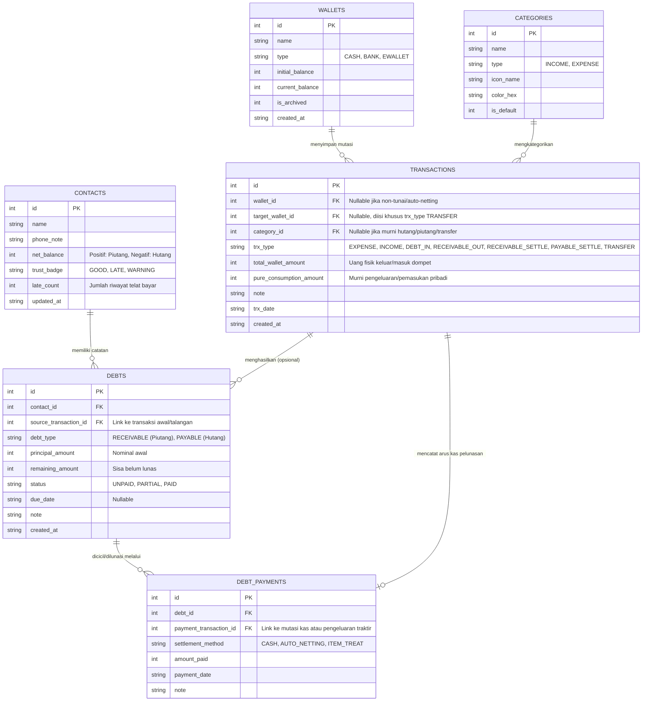

# Entity-Relationship Diagram (ERD) & Skema Database
**Sistem Database:** SQLite 3 (Lokal / *Offline-First*)  
**Desain Arsitektur:** *Unified Ledger with Linked Debt Sub-ledger*

---

## 1. Diagram Relasi Entitas (ERD)

Berikut adalah diagram struktur tabel yang menggabungkan pencatatan arus kas harian dengan buku hutang-piutang:



---

## 2. Spesifikasi Detail Tabel (Data Dictionary)

### 2.1. Tabel `wallets` (Dompet / Akun Kas)
Menyimpan sumber dana pengguna (misal: Dompet Tunai, Rekening BCA, GoPay).
* `id`: Primary Key.
* `initial_balance`: Saldo awal saat dompet dibuat (dalam satuan Rupiah penuh, `INTEGER`).
* `current_balance`: Saldo aktif saat ini ($S_{\text{dompet}}$), diperbarui otomatis setiap ada transaksi kas.

### 2.2. Tabel `categories` (Kategori Kas)
Menyimpan kategori pemasukan dan pengeluaran konsumsi pribadi. Transaksi pinjam-meminjam murni tidak wajib memiliki `category_id` agar tidak mengotori grafik kategori bulanan.

### 2.3. Tabel `contacts` (Buku Kontak Teman)
Menyimpan daftar nama orang yang bertransaksi hutang-piutang dengan pengguna.
* `net_balance`: Kolom *cache* hasil kalkulasi $\sum \text{remaining\_amount (RECEIVABLE)} - \sum \text{remaining\_amount (PAYABLE)}$.
  * Nilai $> 0$ berarti teman berhutang ke pengguna.
  * Nilai $< 0$ berarti pengguna berhutang ke teman.

### 2.4. Tabel `transactions` (Jurnal Arus Kas & Konsumsi)
Kunci utama pemisahan antara **uang dompet keluar** dan **pengeluaran konsumsi** terletak pada dua kolom nominal di tabel ini:
* `total_wallet_amount`: Nominal uang riil yang keluar/masuk dari `wallets` (memengaruhi `current_balance`).
* `pure_consumption_amount`: Nominal yang benar-benar dihitung sebagai Pengeluaran atau Pemasukan di laporan bulanan.

### 2.5. Tabel `debts` (Item Hutang / Piutang)
Menyimpan daftar tagihan per kontak. Satu baris di `transactions` dapat menghasilkan satu atau beberapa baris di `debts` (contohnya pada kasus makan bersama / talangan beberapa teman sekaligus).

### 2.6. Tabel `debt_payments` (Riwayat Cicilan & Pelunasan)
Menyimpan histori pembayaran bertahap maupun pelunasan penuh atas suatu item di tabel `debts`, baik dibayar tunai (`CASH`), potong saldo silang (`AUTO_NETTING`), maupun traktiran/barang (`ITEM_TREAT`).

---

## 3. Simulasi Alur Data pada 5 Skenario Utama

Berikut adalah cara tabel-tabel di atas bekerja sama menangani skenario nyata di dalam aplikasi:

### Skenario A: Pengeluaran Pribadi Murni (Beli Makan Rp25.000)
1. **Insert `transactions`:**
   * `trx_type` = `'EXPENSE'`
   * `total_wallet_amount` = $25000$
   * `pure_consumption_amount` = $25000$
2. **Update `wallets`:** `current_balance` berkurang $25000$.
3. Tabel `debts` tidak disentuh.

### Skenario B: Meminjamkan Uang Tunai ke Budi Rp100.000 (Piutang Murni)
1. **Insert `transactions`:**
   * `trx_type` = `'RECEIVABLE_OUT'`
   * `total_wallet_amount` = $100000$
   * `pure_consumption_amount` = $0$ *(Tidak mengotori grafik pengeluaran bulanan)*
2. **Insert `debts`:**
   * `contact_id` = ID Budi, `source_transaction_id` = ID Transaksi di atas
   * `debt_type` = `'RECEIVABLE'`, `principal_amount` = $100000$, `remaining_amount` = $100000$, `status` = `'UNPAID'`
3. **Update `wallets`:** `current_balance` berkurang $100000$.
4. **Update `contacts` (Budi):** `net_balance` bertambah $+100000$.

### Skenario C: Pengeluaran Sekaligus Talangi Teman (Bayar Kasir Rp60.000, Porsi Riko Rp30.000)
Hanya dengan satu kali klik simpan di form Pengeluaran, sistem mengeksekusi *database transaction* berikut:
1. **Insert `transactions`:**
   * `trx_type` = `'EXPENSE'`, `category_id` = ID Makan
   * `total_wallet_amount` = $60000$ *(Uang keluar dari dompet)*
   * `pure_consumption_amount` = $30000$ *(Hanya porsi makan pengguna sendiri yang masuk grafik pengeluaran)*
2. **Insert `debts`:**
   * `contact_id` = ID Riko, `source_transaction_id` = ID Transaksi di atas
   * `debt_type` = `'RECEIVABLE'`, `principal_amount` = $30000$, `remaining_amount` = $30000$, `status` = `'UNPAID'`
3. **Update `wallets`:** `current_balance` berkurang $60000$.
4. **Update `contacts` (Riko):** `net_balance` bertambah $+30000$.

### Skenario D: Budi Mencicil Hutangnya Rp40.000 secara Tunai
1. **Insert `transactions`:**
   * `trx_type` = `'RECEIVABLE_SETTLE'` *(Jika pengguna yang membayar hutang ke teman, gunakan `'PAYABLE_SETTLE'`)*
   * `total_wallet_amount` = $40000$
   * `pure_consumption_amount` = $0$ *(Tidak dihitung sebagai pemasukan gaji/pendapatan)*
2. **Insert `debt_payments`:**
   * `debt_id` = ID Piutang Budi, `payment_transaction_id` = ID Transaksi di atas
   * `settlement_method` = `'CASH'`, `amount_paid` = $40000$
3. **Update `debts`:** `remaining_amount` menjadi $60000$ ($100000 - 40000$), `status` = `'PARTIAL'`.
4. **Update `wallets`:** `current_balance` bertambah $+40000$.
5. **Update `contacts` (Budi):** `net_balance` menjadi $+60000$.

### Skenario E: Lunas via Traktiran (*Settle with Item*)
Sisa piutang Budi Rp60.000 dilunasi dengan cara Budi mentraktir makan pengguna seharga Rp60.000:
1. **Insert `transactions`:**
   * `wallet_id` = `NULL` *(Tidak ada uang keluar/masuk dompet pengguna)*
   * `category_id` = ID Makan, `trx_type` = `'EXPENSE'`
   * `total_wallet_amount` = $0$
   * `pure_consumption_amount` = $60000$ *(Tercatat sebagai konsumsi makan pengguna)*
2. **Insert `debt_payments`:**
   * `debt_id` = ID Piutang Budi, `payment_transaction_id` = ID Transaksi di atas
   * `settlement_method` = `'ITEM_TREAT'`, `amount_paid` = $60000$
3. **Update `debts`:** `remaining_amount` menjadi $0$, `status` = `'PAID'`.
4. **Update `contacts` (Budi):** `net_balance` menjadi $0$.

### Skenario F: Transfer Antar Dompet (Tarik Tunai dari Bank BCA ke Dompet Tunai Rp200.000)
1. **Insert `transactions`:**
   * `wallet_id` = ID Bank BCA (Dompet Asal), `target_wallet_id` = ID Dompet Tunai (Dompet Tujuan)
   * `trx_type` = `'TRANSFER'`, `category_id` = `NULL`
   * `total_wallet_amount` = $200000$, `pure_consumption_amount` = $0$ *(Tidak mengotori grafik pengeluaran/pemasukan)*
2. **Update `wallets` (Bank BCA):** `current_balance` berkurang $200000$.
3. **Update `wallets` (Dompet Tunai):** `current_balance` bertambah $200000$.

---

## 4. Implementasi Kode SQLite (DDL Schema)

```sql
PRAGMA foreign_keys = ON;

-- 1. Tabel Dompet
CREATE TABLE wallets (
    id INTEGER PRIMARY KEY AUTOINCREMENT,
    name TEXT NOT NULL,
    type TEXT NOT NULL CHECK (type IN ('CASH', 'BANK', 'EWALLET')),
    initial_balance INTEGER NOT NULL DEFAULT 0,
    current_balance INTEGER NOT NULL DEFAULT 0,
    is_archived INTEGER NOT NULL DEFAULT 0,
    created_at TEXT NOT NULL DEFAULT (datetime('now', 'localtime'))
);

-- 2. Tabel Kategori
CREATE TABLE categories (
    id INTEGER PRIMARY KEY AUTOINCREMENT,
    name TEXT NOT NULL,
    type TEXT NOT NULL CHECK (type IN ('INCOME', 'EXPENSE')),
    icon_name TEXT NOT NULL,
    color_hex TEXT NOT NULL,
    is_default INTEGER NOT NULL DEFAULT 0
);

-- 3. Tabel Kontak Teman
CREATE TABLE contacts (
    id INTEGER PRIMARY KEY AUTOINCREMENT,
    name TEXT NOT NULL UNIQUE,
    phone_note TEXT,
    net_balance INTEGER NOT NULL DEFAULT 0,
    trust_badge TEXT NOT NULL DEFAULT 'GOOD' CHECK (trust_badge IN ('GOOD', 'LATE', 'WARNING')),
    late_count INTEGER NOT NULL DEFAULT 0,
    updated_at TEXT NOT NULL DEFAULT (datetime('now', 'localtime'))
);

-- 4. Tabel Transaksi Utama
CREATE TABLE transactions (
    id INTEGER PRIMARY KEY AUTOINCREMENT,
    wallet_id INTEGER,
    target_wallet_id INTEGER,
    category_id INTEGER,
    trx_type TEXT NOT NULL CHECK (trx_type IN (
        'EXPENSE',
        'INCOME',
        'DEBT_IN',
        'RECEIVABLE_OUT',
        'RECEIVABLE_SETTLE',
        'PAYABLE_SETTLE',
        'TRANSFER'
    )),
    total_wallet_amount INTEGER NOT NULL DEFAULT 0,
    pure_consumption_amount INTEGER NOT NULL DEFAULT 0,
    note TEXT,
    trx_date TEXT NOT NULL,
    created_at TEXT NOT NULL DEFAULT (datetime('now', 'localtime')),
    FOREIGN KEY (wallet_id) REFERENCES wallets(id) ON DELETE SET NULL,
    FOREIGN KEY (target_wallet_id) REFERENCES wallets(id) ON DELETE SET NULL,
    FOREIGN KEY (category_id) REFERENCES categories(id) ON DELETE SET NULL
);

-- 5. Tabel Hutang & Piutang
CREATE TABLE debts (
    id INTEGER PRIMARY KEY AUTOINCREMENT,
    contact_id INTEGER NOT NULL,
    source_transaction_id INTEGER,
    debt_type TEXT NOT NULL CHECK (debt_type IN ('RECEIVABLE', 'PAYABLE')),
    principal_amount INTEGER NOT NULL CHECK (principal_amount > 0),
    remaining_amount INTEGER NOT NULL CHECK (remaining_amount >= 0),
    status TEXT NOT NULL DEFAULT 'UNPAID' CHECK (status IN ('UNPAID', 'PARTIAL', 'PAID')),
    due_date TEXT,
    note TEXT,
    created_at TEXT NOT NULL DEFAULT (datetime('now', 'localtime')),
    FOREIGN KEY (contact_id) REFERENCES contacts(id) ON DELETE CASCADE,
    FOREIGN KEY (source_transaction_id) REFERENCES transactions(id) ON DELETE CASCADE
);

-- 6. Tabel Riwayat Pelunasan / Cicilan Hutang
CREATE TABLE debt_payments (
    id INTEGER PRIMARY KEY AUTOINCREMENT,
    debt_id INTEGER NOT NULL,
    payment_transaction_id INTEGER,
    settlement_method TEXT NOT NULL CHECK (settlement_method IN ('CASH', 'AUTO_NETTING', 'ITEM_TREAT')),
    amount_paid INTEGER NOT NULL CHECK (amount_paid > 0),
    payment_date TEXT NOT NULL,
    note TEXT,
    FOREIGN KEY (debt_id) REFERENCES debts(id) ON DELETE CASCADE,
    FOREIGN KEY (payment_transaction_id) REFERENCES transactions(id) ON DELETE SET NULL
);

-- 7. Tabel Pengaturan Aplikasi (Rem Piutang, Tema, Keamanan, Onboarding)
CREATE TABLE app_settings (
    setting_key TEXT PRIMARY KEY,
    setting_value TEXT NOT NULL
);

INSERT INTO app_settings (setting_key, setting_value) VALUES
    ('lending_cap_limit', '1000000'),
    ('onboarding_prompt_shown', '0'),
    ('theme_mode', 'system'),
    ('app_lock_enabled', '0'),
    ('app_lock_pin', '');

-- Indexes untuk menjaga performa query lokal di bawah 100ms
CREATE INDEX idx_transactions_date ON transactions(trx_date DESC);
CREATE INDEX idx_transactions_type ON transactions(trx_type);
CREATE INDEX idx_transactions_wallet ON transactions(wallet_id, target_wallet_id);
CREATE INDEX idx_debts_contact_status ON debts(contact_id, status);
CREATE INDEX idx_debts_due_date ON debts(due_date) WHERE status != 'PAID';
```