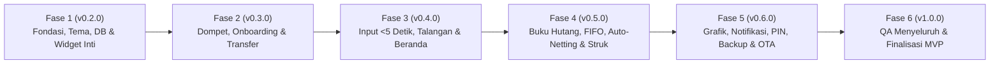

# Rencana Fase Pengerjaan (Development Roadmap)
**Nama Produk:** KasKita – Pencatat Keuangan & Buku Hutang Mandiri (Offline-First)  
**Target Rilis:** `v1.0.0` (MVP Lengkap)  

Setiap fase dirancang secara modular mengikuti aturan di [AGENTS.md](../AGENTS.md) dan workflow di [.agents/skills/feature-development/SKILL.md](../.agents/skills/feature-development/SKILL.md). Setiap selesai satu fase, dilakukan pengujian otomatis (`flutter test` & `flutter analyze`), pembaruan versi di [README.md](../README.md), dan sinkronisasi [docs/user_manual.typ](user_manual.typ).

---

## Ringkasan Alur Fase

---

## Detail Setiap Fase Pengerjaan

### Fase 1: Fondasi Inti, Tema *Tactile Ledger*, Database SQLite, & Komponen Reusable (`v0.2.0`) — [SELESAI]
**Fokus:** Menyiapkan lapisan `lib/core/` agar seluruh fitur memiliki fondasi database yang kokoh dan komponen UI *Anti-AI-Slop* yang konsisten.
1. **Instalasi & Konfigurasi Dependensi (`pubspec.yaml`):**
   * Utama: `flutter_riverpod`, `sqflite`, `path`, `equatable`, `collection`, `intl`, `google_fonts`, `lucide_icons_flutter`, `table_calendar`, `fl_chart`, `flutter_local_notifications`, `timezone`, `local_auth`, `flutter_secure_storage`, `screenshot`, `share_plus`, `path_provider`, `file_picker`, `csv`, `package_info_plus`, `url_launcher`.
   * Pengujian (Dev): `sqflite_common_ffi` (untuk pengujian unit SQLite langsung di Windows).
2. **Design System & Tema (`lib/core/theme/`):**
   * Palet warna *Light Mode* (`#F7F6F2` *Warm Alabaster*) & *Dark Mode* (`#0E1014` *Carbon Slate*).
   * Tipografi **Plus Jakarta Sans** dengan dukungan `FontFeature.tabularFigures()` pada seluruh gaya angka.
3. **DatabaseHelper SQLite (`lib/core/database/`):**
   * Pembuatan 7 tabel utama (`wallets`, `categories`, `contacts`, `transactions`, `debts`, `debt_payments`, `app_settings`) beserta *indexes* performa `<100ms`.
   * *Seeding* otomatis `"Dompet Tunai"` dan 10 kategori bawaan (6 Pengeluaran, 4 Pemasukan).
   * Kerangka migrasi bertahap `onUpgrade` sesuai skill `sqlite-schema-migration`.
4. **Katalog Komponen Reusable (`lib/core/widgets/`):**
   * `TactileCard`: Kontainer kartu dengan *border* tegas `1px solid` tanpa bayangan berlebihan.
   * `TabularCurrencyText`: Widget khusus penampil nominal Rupiah sejajar.
   * `StatusBadge`: Label status tagihan (`UNPAID`, `PARTIAL`, `PAID`) & *Trust Badge* (`GOOD`, `LATE`, `WARNING`).
   * `CustomNumpad`: Keypad angka `4x4` terintegrasi dengan *quick chips* (`+10rb`, `+20rb`, `+50rb`, `+100rb`, `Reset`).
   * `EmptyStateView`: Tampilan kosong yang bersih dan informatif.
* **Kriteria Selesai (DoD):** Aplikasi dapat dijalankan dengan tema Light/Dark, database SQLite terbentuk sempurna, dan *unit test* helper format Rupiah lulus.

---

### Fase 2: Manajemen Dompet, Kategori, Onboarding Saldo Awal, & Kerangka Navigasi (`v0.3.0`) — [SELESAI]
**Fokus:** Membangun modul `lib/features/wallets/` dan struktur navigasi utama 3 Tab.
1. **Lapisan Data & Provider Dompet/Kategori:**
   * Model & Repository untuk CRUD `wallets` dan `categories`.
   * Kalkulator indikator keuangan utama: Saldo Dompet Aktif ($S_{\text{dompet}}$), Dana Aman Siap Pakai ($D_{\text{aman}}$), dan Kekayaan Bersih ($W_{\text{bersih}}$).
2. **Kerangka Navigasi Utama (`AppShell`):**
   * *Bottom Navigation Bar* dengan 3 Tab (*Beranda*, *Buku Hutang*, *Ringkasan & Pengaturan*) + tombol aksi utama `+`.
3. **Alur Pertama Kali Buka (*Onboarding Dialog*):**
   * Dialog opsional pengisian **Saldo Awal Dompet Tunai** saat aplikasi pertama kali dibuka (`onboarding_prompt_shown == '0'`).
4. **Manajemen Multi-Dompet & Transfer Antar Dompet (`TRANSFER`):**
   * Tambah/edit/arsipkan dompet (`CASH`, `BANK`, `EWALLET`).
   * Transaksi **Transfer Antar Dompet** dalam satu `db.transaction` tanpa mengotori grafik pengeluaran/pemasukan.
5. **Kartu Buku Kas Terpadu (*Unified Ledger Card*):**
   * Komponen header Beranda yang menampilkan filter pill dompet, tombol pintas `⇄ Transfer`, serta angka $S_{\text{dompet}}$, $D_{\text{aman}}$, dan $W_{\text{bersih}}$.
* **Kriteria Selesai (DoD):** *Unit test* kalkulasi $S_{\text{dompet}}, D_{\text{aman}}, W_{\text{bersih}}$ dan mutasi *Transfer Antar Dompet* lulus 100%.

---

### Fase 3: Input Satu Pintu (`< 5 Detik`), Talangan Teman, & Beranda Gaya *Money Manager* (`v0.4.0`) — [SELESAI]
**Fokus:** Membangun modul `lib/features/transactions/` dengan alur input cepat dan pengelompokan tanggal/bulan ala *Money Manager (Realbyte)*.
1. **Bottom Sheet Input Satu Pintu (`+`):**
   * *Segmented Mode Switcher*: `Pengeluaran` | `Pemasukan` | `Piutang` | `Hutang` | `⇄ Transfer`.
   * Integrasi `CustomNumpad`, pemilih Dompet, Kategori/Kontak, Tanggal, dan Catatan tanpa memicu *layout shift* keyboard OS.
2. **Fitur "Sekalian Talangi Teman" (*Inline Split Expense*):**
   * Toggle talangan pada form Pengeluaran, pemilihan kontak teman, tombol **Bagi Rata (50:50)** atau porsi manual, serta ringkasan otomatis (*Keluar Dompet* vs *Konsumsi Pribadi* vs *Piutang Teman*).
   * Penyimpanan atomik ke `transactions`, `wallets`, `debts`, dan `contacts`.
3. **Tampilan Beranda Gaya *Money Manager (Realbyte)*:**
   * Navigasi periode `◀ Nov 2026 ▶` dan bar ringkasan 3 kolom (`Pemasukan`, `Pengeluaran Murni`, `Selisih`).
   * **Sub-Tab `Harian`:** Blok kartu per tanggal dengan angka tanggal besar (`20sp`), *badge* hari (`Sen`–`Min`), keterangan `BB.TTTT`, subtotal pemasukan & pengeluaran murni hari tersebut di kanan atas, serta daftar item transaksi di bawahnya.
   * **Sub-Tab `Kalender`:** Grid kalender bulanan dengan ringkasan angka harian di tiap kotak tanggal + detail transaksi di bawahnya saat tanggal diketuk.
   * **Sub-Tab `Bulanan`:** Rekapitulasi Januari s.d. Desember beserta rincian mingguan (*expandable*).
4. **Edit & Hapus Transaksi (*Rollback Safety*):**
   * Rollback otomatis saldo dompet & hutang saat transaksi diubah/dihapus, serta penguncian otomatis jika transaksi talangan sudah memiliki cicilan masuk.
* **Kriteria Selesai (DoD):** *Unit test* pemisahan `total_wallet_amount` dan `pure_consumption_amount` pada skenario Talangan lulus.

---

### Fase 4: Buku Hutang Pintar: Cicilan FIFO, Auto-Netting, Lunas Traktiran, & Struk Gambar (`v0.5.0`)
**Fokus:** Membangun modul `lib/features/debts/` (Tab 2) beserta seluruh skenario pelunasan fleksibel.
1. **Halaman Buku Hutang & Direktori Kontak (Tab 2):**
   * Header ringkasan Total Piutang di Teman ($P_{\text{aktif}}$) vs Total Hutang Saya ($H_{\text{aktif}}$) + indikator bar **Rem Piutang (*Lending Cap*)**.
   * Filter cepat: *Semua*, *Mereka Hutang*, *Saya Hutang*, *Jatuh Tempo*.
   * Kartu kontak dengan satu angka **Saldo Bersih ($B_{\text{kontak}}$)** dan evaluasi otomatis **Trust Badge (`GOOD`, `LATE`, `WARNING`)**.
2. **Halaman Detail Kontak & Cicilan FIFO:**
   * Daftar tagihan aktif dan riwayat pembayaran per kontak.
   * Form **Bayar / Cicil** dengan alokasi **Otomatis FIFO** (memotong tagihan terlama lebih dulu) maupun opsi **Pilih Tagihan Spesifik**.
3. **Saling Silang Saldo Otomatis (*Auto-Netting*):**
   * Deteksi otomatis saat mencatat hutang/piutang baru pada kontak yang memiliki saldo berlawanan -> menawarkan opsi **"Potong langsung dari piutang/hutang sebelumnya"** tanpa memindahkan uang fisik.
4. **Lunas via Barang / Traktiran (*Settle with Item*):**
   * Pelunasan non-tunai (`settlement_method = 'ITEM_TREAT'`, `wallet_id = NULL`) dengan opsi centang *"Catat sebagai konsumsi harian"*.
5. **Banner Peringatan Rem Piutang & *Clean Invoice Receipt*:**
   * Peringatan di form input saat total piutang melewati batas `lending_cap_limit`.
   * Render kartu struk tagihan bersih via `RepaintBoundary` menjadi PNG dan bagikan ke WhatsApp (`share_plus`).
* **Kriteria Selesai (DoD):** *Unit test* algoritma FIFO multi-tagihan, *Auto-Netting*, *Settle with Item*, dan aturan *Trust Badge* lulus 100%.

---

### Fase 5: Laporan Grafik, Notifikasi Jatuh Tempo, PIN/Biometrik, Backup, & Update OTA (`v0.6.0`)
**Fokus:** Membangun modul `lib/features/reports/` dan `lib/features/settings/` (Tab 3).
1. **Visualisasi Grafik Bulanan (`fl_chart`):**
   * Diagram batang perbandingan **Pengeluaran Konsumsi Murni** vs **Uang Tertahan di Teman (Piutang)** per bulan.
   * Rincian persentase dan nominal pengeluaran per kategori.
2. **Notifikasi Lokal Jatuh Tempo:**
   * Penjadwalan pengingat otomatis H-1 dan Hari-H pukul 09.00 pagi menggunakan `flutter_local_notifications`.
3. **Penguncian Aplikasi (PIN 6 Digit & Biometrik):**
   * *Lock screen* menggunakan autentikasi sidik jari/wajah (`local_auth`) atau PIN lokal.
4. **Manajemen Data Lokal (Backup, Restore, & Ekspor CSV):**
   * Backup & Restore database (`.json` / `.db` dengan validasi versi skema) serta ekspor laporan transaksi ke `.csv`.
5. **Cek Pembaruan Aplikasi Otomatis (OTA / GitHub Releases):**
   * Pengecekan rilis terbaru ke `https://api.github.com/repos/Madik1139/kaskita/releases/latest` dan tombol unduh pembaruan langsung.
* **Kriteria Selesai (DoD):** Backup/Restore `.json` teruji melalui *unit test* tanpa kehilangan data.

---

### Fase 6: Pengujian Menyeluruh (*End-to-End QA*), Optimasi Performa, & Finalisasi Rilis (`v1.0.0`)
**Fokus:** Pemolesan akhir, pengujian beban data, dan sinkronisasi seluruh dokumentasi.
1. Eksekusi penuh seluruh *unit test* (`flutter test`) dan analisis statis (`flutter analyze` -> 0 error/warning).
2. Verifikasi kecepatan query (`<100ms`) dan kehalusan transisi UI pada *Light Mode* & *Dark Mode*.
3. Pembaruan akhir [README.md](../README.md), kompilasi [docs/user_manual.typ](user_manual.typ), dan *push* rilis `v1.0.0` ke GitHub.

